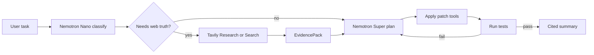

# Architecture

## Overview

GroundTruth is a loop, not a chat wrapper. Each run moves through grounded planning, constrained editing, and verification.

## Components

### `groundtruth.nemotron`

OpenAI compatible client pointed at Nebius Token Factory. Exposes `complete()` and `route(task)` which returns `nano`, `super`, or `ultra`.

### `groundtruth.tavily`

Builds `EvidencePack` via Research `output_schema`, or Search plus Extract for narrow doc lookups. Writes cache files keyed by query hash.

### `groundtruth.tools`

Sandboxed tools: read file, write file, run shell (allowlisted commands), list directory. Workspace root is configurable; default is `fixtures/sample_project`.

### `groundtruth.agent`

Orchestrates the loop, enforces "no patch without evidence" when risk is high, and persists run records.

### `groundtruth.memory`

Local JSON store for stack notes, conventions, and prior evidence pack IDs. Optional export to skill markdown for personal assistant workflows.

### `groundtruth.api`

FastAPI endpoints: `POST /runs`, `GET /runs/{id}`, SSE or polling for log streams.

### `apps/web`

React dashboard: task input, run timeline, citations panel, model tier badge per step.

## Data on disk

| Path | Purpose |
|------|---------|
| `data/memory/` | Personal memory (gitignored) |
| `data/evidence_cache/` | Tavily responses for demos |
| `data/runs/` | Run metadata and token stats |

## Security notes

- API keys stay server side only.
- Shell tool uses an allowlist (`pytest`, `python`, `npm test`, etc.).
- Never point the agent at a repository root you are not willing to modify.

## Implementation status

Scaffold only until agent modules are filled in. Track progress in GitHub issues or the root README checklist.
